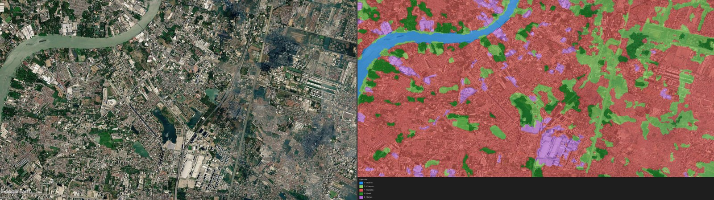
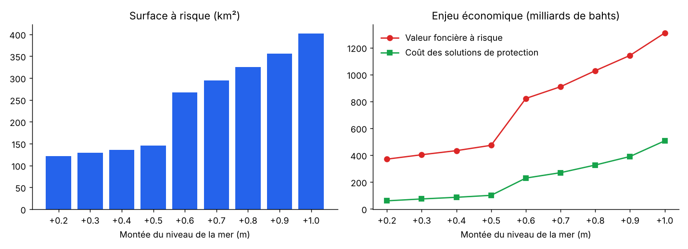
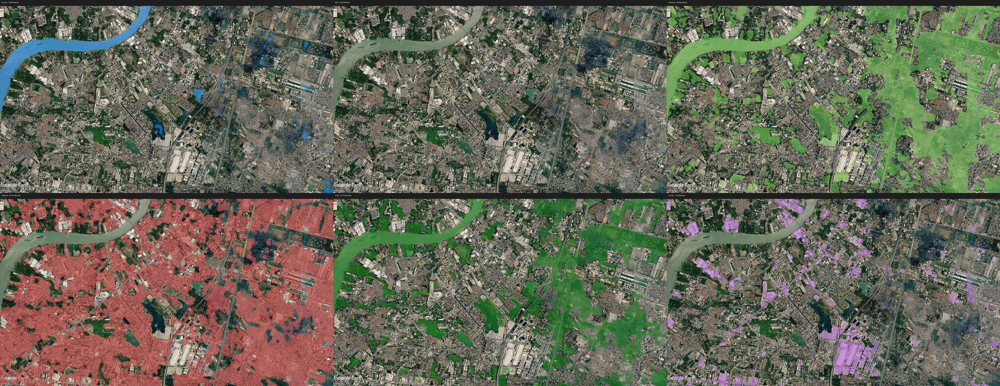

# Montée des eaux et risque économique : IA et imagerie satellite (Thaïlande)

Projet réalisé pendant mon **stage de recherche à Burapha University** (Chonburi, Thaïlande, juin à septembre 2026).

L'objectif était d'estimer, pour la côte Est de la Thaïlande (région du *Eastern Economic Corridor*), **quelles zones seraient inondées selon plusieurs scénarios de montée du niveau de la mer, ce qu'elles valent et quelle protection serait la plus rentable**. Le pipeline part des images satellite brutes et aboutit à un outil d'aide à la décision pour les pouvoirs publics.


*Gauche : image satellite d'origine. Droite : occupation du sol prédite (rivière, champs, habitations, forêt, zones industrielles).*

## Résultats

Zone étudiée : **184 tuiles, environ 7 750 km²**, à une résolution de 5 m par pixel. Neuf scénarios de montée des eaux, de +0,2 m à +1,0 m.



| Montée des eaux | Surface à risque | Valeur foncière à risque | Coût des protections recommandées |
|---|---|---|---|
| +0,2 m | 122 km² | 371 Md฿ | 60 Md฿ |
| +0,5 m | 145 km² | 473 Md฿ | 101 Md฿ |
| +0,6 m | 267 km² | 822 Md฿ | 230 Md฿ |
| +1,0 m | 402 km² | 1 309 Md฿ | 507 Md฿ |

*Md฿ : milliards de bahts.*

**Enseignement principal : il existe un seuil autour de +0,5 m / +0,6 m.** Au-delà, la surface et la valeur exposées font presque le double en un seul palier de 10 cm, ce qui en fait un horizon clé pour planifier les protections.

## Pipeline

```
Images satellite ─► Occupation du sol (CNN + autoencodeurs) ─► Croisement avec les scénarios d'inondation
                                                                  │
                     Prix du foncier (barème du Trésor thaï) ─────┤
                                                                  ▼
                                         Zones à risque ─► Solution recommandée + coût ─► Rapport Excel
```

### 1. Occupation du sol par deep learning

Chaque image est découpée en patchs de 16 × 16 pixels par **fenêtre glissante** (pas de 4 px). Les probabilités sont moyennées pixel par pixel, ce qui donne une carte de classes à la résolution de l'image.

| Classe | Modèle |
|---|---|
| Rivière, Mer, Habitations, Usines | **CNN binaire** (3 blocs convolution, ReLU et max-pooling, puis classifieur dense avec dropout) |
| Forêt, Champs | **Autoencodeur convolutionnel** entraîné sur une seule classe : un patch est reconnu quand son erreur de reconstruction est faible. Le seuil de décision est calibré sur la distribution des erreurs. |

Pour Forêt et Champs, l'approche « une seule classe » évite de constituer un jeu de contre-exemples exhaustif pour des classes très hétérogènes.

Un **post-traitement morphologique** nettoie ensuite la carte :
- suppression des zones trop petites ;
- rivières conservées seulement si elles sont connectées à un grand cours d'eau ;
- correction des champs détectés à tort près de la côte (eau trouble) ;
- vote local pour les pixels non classés.


*Détection brute de chaque modèle. En haut : rivière, mer, champs. En bas : habitations, forêt, usines.*

### 2. Croisement avec les scénarios et évaluation économique

Pour chaque scénario, de +0,2 m à +1,0 m :
- **Zones exposées** : inondation directe, zones tampons autour des bâtiments (30 m pour les habitations, 60 m pour les usines) et **îlots enclavés**, c'est-à-dire des zones non inondées mais encerclées par l'eau.
- **Valeur foncière** : prix par pixel selon l'usage (résidentiel, industriel, agricole), d'après le barème officiel du Trésor thaï, avec conversion d'unités de ตารางวา (4 m²) en m².
- **Fusion inter-tuiles** : les zones à risque qui se prolongent d'une tuile à l'autre sont regroupées (*union-find*).

### 3. Recommandation de protection

Pour chaque zone, un arbre de décision chiffre et choisit une solution :
- **Mangrove** si la place disponible jusqu'à la côte est suffisante (au moins 100 m) ;
- sinon **remblai** pour les zones agricoles, ou **digue** dans les autres cas (volume calculé avec la géométrie standard USACE) ;
- **relocalisation** si la protection coûte plus de 50 % de la valeur à protéger.

Les coûts unitaires viennent de références publiées (USACE, Banque mondiale, littérature sur la restauration de mangroves) et sont documentés dans le code.

## Utilisation

```bash
pip install -r requirements.txt

# Carte d'occupation du sol d'une image (exemple fourni)
python src/predict_map.py --image examples/Tuile48.jpg --stride 4 --output Tuile48_map.png

# Détection séparée des 6 classes + carte complète
python src/predict_all_classes.py --image examples/Tuile48.jpg --output-dir out/

# Traitement par lots de toutes les tuiles, puis analyse multi-scénarios -> Excel
python src/run_all.py
python src/analyze_flood_risk_multiscenario.py
```

Les modèles entraînés sont fournis dans `models/`. Les données d'entrée complètes (plus de 500 tuiles, cartes d'inondation, prix du foncier) ne sont pas versionnées à cause de leur volume (plusieurs Go).

## Structure

```
src/
├── predict_map.py                        # fenêtre glissante + post-traitement -> carte de classes
├── predict_all_classes.py                # détection séparée des 6 classes
├── predict_classifier.py                 # détection d'une seule classe (CNN binaire)
├── run_all.py                            # traitement par lots, reprise automatique
└── analyze_flood_risk_multiscenario.py   # exposition, valeur, solutions -> Excel
scripts/
└── gistda_ecoplant.py                    # collecte automatisée (Selenium) des cartes de cultures GISTDA
models/                                   # poids PyTorch (CNN + autoencodeurs) et seuils calibrés
examples/                                 # une tuile d'exemple
```

## Données

- Imagerie satellite : © Google Earth (tuiles d'exemple uniquement, à des fins de démonstration).
- Cartes de cultures : [GISTDA Ecoplant](https://ecoplant.gistda.or.th).
- Prix du foncier : barème d'évaluation du Département du Trésor thaïlandais.

## Stack

Python · PyTorch · CNN · autoencodeurs · NumPy · SciPy (morphologie, labellisation) · Pillow · Selenium · openpyxl
